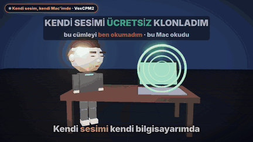
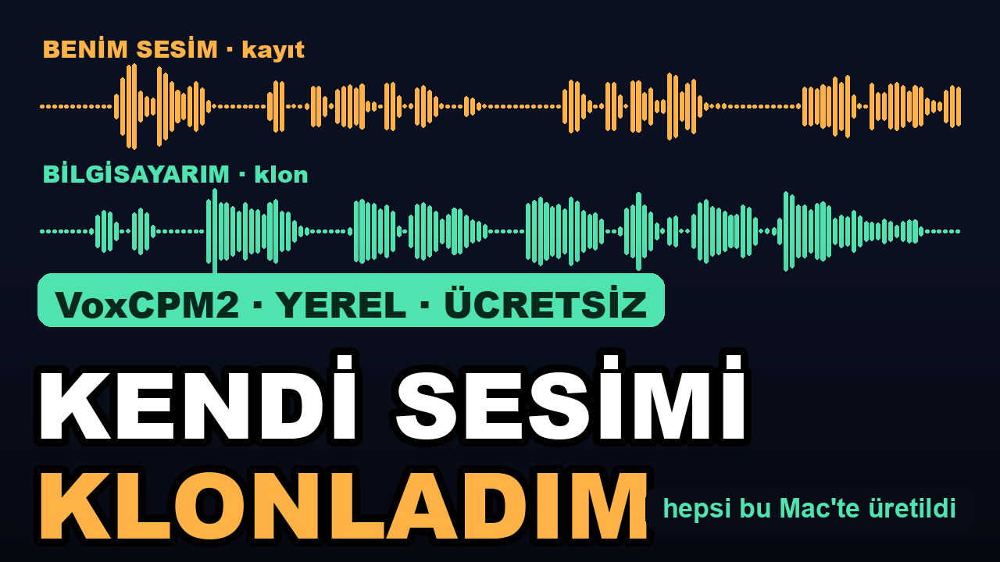

# Kendi sesimi bilgisayarımda klonladım: VoxCPM2 ile yerel Türkçe ses (ücretsiz, ölçerek)

Bu videodaki anlatımın tamamı benim sesim değil: 12 saniyelik kaydımdan bu Mac'te, VoxCPM2 ile üretildi. Videoda gerçek sesimi yalnız bir kez duyuyorsun.

Her şeyi gerçekten denedim ve her örneği dinletiyorum: referansla klon, sadece tarifle ses tasarımı, 171 kelimelik uzun hikâye, iki sesli kısa diyalog ve cümle cümle üretim + birleştirme hattı. Ekrandaki bütün sayılar bu geceki deneylerin ölçümü.

## Bu videoda

- Kurulum: VoxCPM2 (2B, 30 dil, Apache-2.0) ayrı Python ortamında yerel sunucu, 127.0.0.1:8123, bir seferde tek istek
- Klonun üç kipi: yalnız referans ses, devam kipi (ses + yazısı), ikisi birden (bizim hat)
- cfg_value (1,55 / 2,0 / 2,6) ve adım sayısı (10 ↔ 25) neyi değiştiriyor
- "Sunucu aynı isteği önbellekten verir" sandık: aynı istek iki kez → iki farklı dosya (sha256 ile)
- Tarifle ses tasarımı: aynı tarif iki çekimde iki ayrı kişi; çözüm beğendiğin çekimi referans yapıp kilitlemek
- Uzun metin tek istekte: kelimeler doğru ama ses yavaş yavaş başkasına dönüşüyor ve hızlanıyor
- Cümle cümle hat: okunuş sözlüğü, −42 dB kırpma, 4 kapı (hız · Whisper · perde/tını · hece), 0,04 sn birleştirme, timing.json, −14 LUFS
- Kısa diyalog: iki ses, 0,04 sn aralık ↔ doğal aralık, görüntü timing.json'a kilitli

## Ölçülen sonuçlar

- Bu Mac'te üretim ≈ söyleme süresinin 2 katı; gecenin ilk isteği 56,6 sn, makine meşgulken bir cümle 70 sn'yi buldu
- cfg 1,55 / 2,0 / 2,6: perde sapması %12,2 / %6,7 / %4,5, üçü de Whisper 1,00
- Tarif: aynı tarif 149 Hz ↔ 213 Hz; kilitli sesle 6 cümlede perde en çok %17 saptı
- Uzun hikâye tek istek: 185 sn üretim, 66,7 sn ses, Whisper %98,7; tını 0,22–0,33'ten 0,67'ye, hız 2,7 → 3,5 kelime/sn
- Aynı hikâye cümle cümle: 15 cümlenin hepsi tını sınırının (0,42) altında, en çok 0,36; iki cümle hız kapısının altında
- Okunuş: ffmpeg ham yazımla "Fehfenpek" duyuldu; RAG sözlükte yok → "Rak" ve Whisper kapısı yine de %97 ile geçirdi

## Bölümler

- 00:00 Giriş
- 00:59 1 · Kurulum ve sunucu: VoxCPM2 · 127.0.0.1:8123 · bir seferde tek istek
- 01:56 2 · Referansla klon: kayıt + yazısı · cfg · adım · önbellek
- 03:59 3 · Tarifle ses tasarımı: kayıt yok · tarif parantez içinde
- 05:37 4 · Cümle cümle üretim: okunuş · kırpma · 4 kapı · birleştirme
- 07:10 5 · Uzun hikâyede ne oluyor: 171 kelime · tek istek ↔ 15 cümle
- 08:36 6 · Kısa diyalog: iki ses · 8 replik · Audio Lock
- 09:38 7 · Notlar: HeyGen ile kısa karşılaştırma
- 10:04 Özet ve sıradaki bölüm

Deney betikleri ve bütün ölçümleri paylaşacağız; bağlantı hazır olunca bu açıklamaya eklenecek.

Videoda gerçek sesimi kaç kez duydun? Yorumlara yaz, cevap sabit yorumda.

#voxcpm #tts #sesklonlama

Tam video dosyası boyutu nedeniyle bu depoda yok; GIF videonun ilk 10 saniyesidir.

## Lisans

Bu depodaki kapak, GIF ve metinler MIT lisanslıdır (LICENSE).
